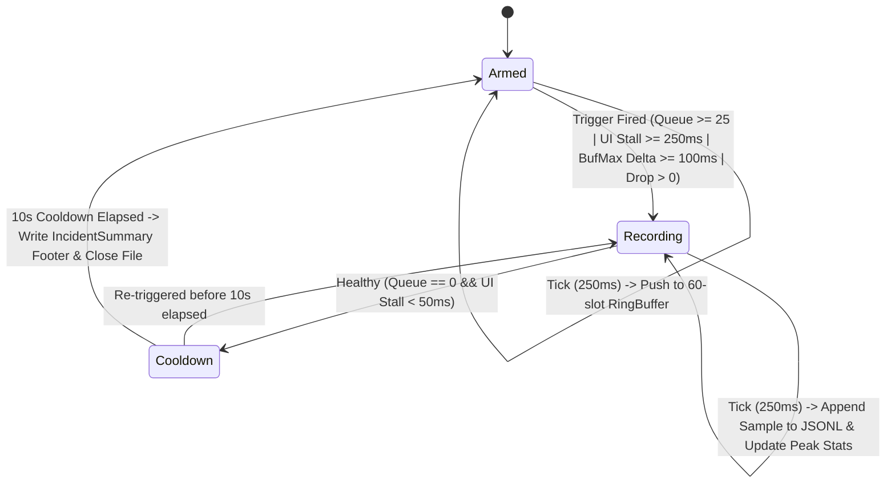

# Specification: Automatic Metrics Flight Recorder & In-App Diagnostic Engine

**Document ID:** `specs/2026-10-16_METRICS_FLIGHT_RECORDER_AND_AUTO_DIAGNOSIS_SPEC.md`  
**Date:** 2026-10-16  
**Status:** APPROVED (Ready for Implementation)  
**Target:** Windows (USN + Search + UI telemetry) & macOS/Linux (Search + UI + Index telemetry; full cross-platform unit tests for ring buffer, trigger state machine, and diagnostic rules)  
**Standard:** C++17 Strict, Dear ImGui, doctest  

---

## 1. Executive Summary & Problem Statement

### 1.1 Context & Motivation
When FindHelper experiences a transient multi-second UI freeze or a sudden USN journal backlog (e.g., `Max Queue Depth: 5051`), manual screenshots of the Metrics window face three fundamental limitations:
1. **The UI thread cannot render while frozen:** Screenshots can only be captured *after* the main thread unblocks, missing the onset of the stall.
2. **Cumulative counters mask transient spikes:** Metrics like `Avg Process Time/Buffer` ($0.65\text{ ms}$) and `Lock Wait Share` ($0.1\%$) are diluted over hours of uptime, hiding a 3-second spike unless two snapshots are manually diffed ($\Delta$).
3. **Raw numbers require forensic math to interpret:** Determining whether a stall was caused by USN Stage-1 CPU work, `FileIndex` lock contention from a concurrent search, a UI-thread `RebuildPathBuffer()` compaction, or a flood of NTFS metadata events requires cross-correlating 15+ counters across USN, Search, and Index sections.

### 1.2 Solution Overview (Confirmed Design Decisions)
This specification introduces two tightly integrated capabilities that are **always armed by default** (no settings toggle required):
1. **Automatic Metrics Flight Recorder (`MetricsFlightRecorder`)**:
   - Continuously samples a lightweight `MetricsSample` ($< 256\text{ bytes}$) every `250 ms` into a fixed-size in-memory **pre-roll ring buffer** (`60` samples = `15 seconds` of history, $< 16\text{ KB}$ total RAM, zero heap allocations after startup).
   - Automatically transitions from `Armed` to `Recording` when any **Incident Trigger** fires:
     - USN queue depth $\ge 25$ (outside initial index population)
     - Single-buffer `usn_max_buffer_process_ms` jump $\ge 100\text{ ms}$
     - UI frame stall $\ge 250\text{ ms}$
     - Any USN buffer drop (`usn_buffers_dropped` increase)
   - Streams **both** a structured `.jsonl` file (`flight_record_<YYYYMMDD_HHMMSS>.jsonl`, containing a metadata header, sample objects, and an `incident_summary` footer with the automatic diagnosis) **and a companion `.csv` file** (`flight_record_<YYYYMMDD_HHMMSS>.csv`, containing a flat header row and one row per `250 ms` sample for direct spreadsheet/charting import) in `~/.FindHelper/diagnostics/`.
   - Retention is bounded to the most recent `10` incident pairs (`10` `.jsonl` + `10` `.csv` files).
2. **In-App Automatic Diagnostic Engine (`MetricsDiagnosticAnalyzer`)**:
   - A pure, stateless C++17 rule engine that evaluates **windowed deltas ($\Delta$)** between samples (not just cumulative lifetime totals) and produces human-readable **`DiagnosticFinding`** cards.
   - Displays both **Live Diagnostics** and a sticky **"Last Incident Post-Mortem"** card at the top of [`MetricsWindow`](file:///Users/brunoorsier/dev/USN_WINDOWS/src/ui/MetricsWindow.cpp), so opening the Metrics window *after* a freeze immediately explains what happened, why, and which subsystem was responsible.

---

## 2. In-App Automatic Diagnosis: How the App Interprets the Numbers

Yes — we can and should run automatic diagnosis directly inside the app. Crucially, the analyzer must evaluate **windowed deltas** ($\Delta = \text{Sample}_t - \text{Sample}_{t-k}$) during an incident window rather than lifetime ratios, because after 100,000 normal buffers a 3-second stall barely moves lifetime averages.

### 2.1 Diagnostic Rule Catalog

Each rule inspects a pair of `MetricsSample` snapshots (`baseline` at incident start or $t - 1\text{s}$, and `current` / `peak` at incident end) and emits a structured `DiagnosticFinding`:

| Rule ID | Diagnosis Title | Trigger Formula (on Windowed $\Delta$) | Plain-English Interpretation Shown in UI |
|---|---|---|---|
| **`DIAG_UI_FRAME_STALL`** | **UI Thread Stall Detected** | `max_ui_frame_delta_ms >= 250` | *"Main UI thread froze for `X ms` (min FPS `Y`)." Sub-classified by rules below:* |
| ↳ **`DIAG_INDEX_REBUILD_ON_UI`** | **Index Path-Buffer Compaction** | `delta_index_rebuilds > 0` during UI stall window | *"UI stall coincided with `FileIndex` path-buffer compaction (`N` deleted entries reclaimed). Search and USN apply were briefly blocked waiting on the index lock."* |
| ↳ **`DIAG_USN_LOCK_CONTENTION`** | **USN Blocked by Search / Index Lock** | `delta_process_time_ms >= 100` AND `delta_lock_wait_ms / delta_process_time_ms >= 0.35` | *"USN processor spent `X%` (`Y ms`) of its time waiting to acquire `FileIndex` exclusive lock while searches or maintenance held shared/exclusive locks."* |
| ↳ **`DIAG_USN_CPU_APPLY_SPIKE`** | **USN CPU-Bound Apply Spike (Non-Lock)** | `delta_process_time_ms >= 100` AND `delta_lock_wait_ms / delta_process_time_ms < 0.15` | *"USN processor spent `X ms` in CPU-bound buffer processing (`Y` records/buffer, lock wait only `Z ms`). Typical causes: large directory tree delete/rename or unindexed parent resolution."* |
| **`DIAG_USN_INGEST_STORM`** | **High-Volume Filesystem Burst** | `queue_depth >= 100` AND `live_buffers_per_sec >= 200` AND `avg_window_process_ms < 2.0` | *"Filesystem emitted a burst of `N` USN buffers (`R` records/s: `C` created, `D` deleted, `M` modified). Processor is healthy (`P ms/buf`, `L buffers/s`) and draining normally."* |
| **`DIAG_USN_QUEUE_STALLED`** | **USN Processor Stalled With Backlog** | `queue_depth >= 10` AND `delta_buffers_processed == 0` over $\ge 1000\text{ ms}$ | *"USN queue holds `Q` buffers (`Drain ETA: stalled`), no buffers completed in the last `T s`."* |
| **`DIAG_USN_BUFFER_DROPS`** | **USN Queue Overflow (Dropped Buffers)** | `delta_buffers_dropped > 0` OR ` journal_wrap_errors > 0` | *"Critical: `N` USN buffers were dropped because the queue reached max capacity (`10,000`). Index may be out of sync with NTFS until next recrawl/restart."* |
| **`DIAG_PLACEHOLDER_ACCUMULATION`** | **Unresolved Parent Placeholders Growing** | `awaiting_count >= 500` AND `awaiting_oldest_age_ms >= 60000` | *"`N` index entries are waiting on missing parent directories (oldest `A s`)."* |
| **`DIAG_SEARCH_POSTPROCESS_HEAVY`** | **Search Post-Processing Bottleneck** | `last_total_search_ms >= 200` AND `last_postprocess_ms / last_total_search_ms >= 0.70` | *"Last search took `T ms` (`R` results); `P%` was spent materializing paths/filters in post-processing rather than index scanning."* |

### 2.2 What It Would Have Displayed for Your Screenshot Incident
On your captured event (`Max Queue Depth: 5051`, `Max Buffer Process Time` jumping from `316 ms` $\rightarrow$ `677 ms`, `Total Lock Wait Time: 4 ms` $\rightarrow$ `4 ms`, `Files Deleted: +790`, `Files Created: +784`):
- **During the spike (Screenshot 1):**
  - **[WARNING] High-Volume Filesystem Burst + Single-Buffer CPU Spike:** *"Queue peaked at `5,051` buffers (`+1,574` file ops). One USN buffer took `316 ms` of CPU time (`0 ms` lock wait), briefly pausing queue drain while the reader queued incoming buffers. Draining at `1,259 buffers/sec` (ETA `3s`)."*
- **After recovery (Screenshot 2 — Sticky "Last Incident Post-Mortem" Card):**
  - **[RESOLVED] Last Incident (`14s ago`, duration `4.2s`, Peak Queue `5,051`):**
    - **Primary Cause:** `DIAG_USN_CPU_APPLY_SPIKE` — *"Worst buffer took `677 ms` CPU time (`0 ms` lock wait). Zero lock contention (`4 ms` total)."*
    - **Workload:** *"Processed `5,157` buffers (`17,450` records: `+784` created, `+790` deleted, `+159` renamed, `+2,018` modified) at `1,259–1,353 buffers/sec`."*
    - **Flight Record Saved:** `flight_record_20261016_094210.jsonl` *(button: "Copy Path" / "Open Folder")*.

---

## 3. User Stories (Gherkin)

| ID | Priority | Summary | Gherkin |
|---|---|---|---|
| **US-1** | **P0** | Zero-allocation pre-roll ring buffer | **Given** FindHelper is running<br>**When** `250 ms` elapses between ticks<br>**Then** a `MetricsSample` is written to a pre-allocated circular buffer of `60` slots (`15s` history) without heap allocations or blocking `FileIndex` locks. |
| **US-2** | **P0** | Automatic incident trigger & hysteresis drain | **Given** the flight recorder is in `Armed` state<br>**When** `current_queue_depth >= 25`, `max_buffer_process_time_ms` jumps by $\ge 100\text{ ms}$, or UI frame delta $\ge 250\text{ ms}$<br>**Then** the recorder transitions to `Recording`, flushes the `15s` pre-roll to disk, records samples every `250 ms` during the incident, and continues for `10s` of `Cooldown` after `current_queue_depth == 0` and UI frame time $< 50\text{ ms}$. |
| **US-3** | **P0** | In-app live & post-mortem diagnosis | **Given** an incident occurred and resolved before the user opened the Metrics window<br>**When** the user opens `MetricsWindow`<br>**Then** the top **"Diagnostics & Flight Recorder"** section displays both current health (`Healthy`) and the sticky **Last Incident Post-Mortem** with root-cause classification, peak deltas, and a button to open/copy the saved flight record file. |
| **US-4** | **P1** | UI stall detection independent of UI thread | **Given** the main UI thread freezes for `3,000 ms`<br>**When** the UI thread cannot execute frame ticks during the freeze<br>**Then** either the background sampler thread (or the first UI tick upon unfreeze using `last_ui_frame_timestamp_ns`) records `ui_stall_ms = 3000` and triggers the flight recorder with all `15s` of pre-freeze USN/index samples preserved. |
| **US-5** | **P1** | Bounded disk usage & retention | **Given** `~/.FindHelper/diagnostics/` already contains `10` flight record files<br>**When** a new incident completes<br>**Then** the oldest file is pruned so disk usage never exceeds `10` files ($\le 5\text{ MB}$ total), and each incident caps at `1,200` samples (`5 minutes`). |
| **US-6** | **P2** | Manual snapshot / "Record Now" button | **Given** the user is investigating performance in `MetricsWindow`<br>**When** the user clicks **"Dump Flight Record Now"**<br>**Then** the current `15s` pre-roll buffer + current diagnostic report are immediately written to a `.jsonl` file. |

---

## 4. Architecture Overview (C4 Views & Threading Model)

### 4.1 C4 Architecture Views

- **Level 1 — System Context:**
  - **User / Maintainer** views live or post-mortem diagnostics in `MetricsWindow` or inspects `~/.FindHelper/diagnostics/flight_record_*.jsonl` offline.
- **Level 2 — Container (FindHelper Process):**
  - **UI Thread (`Application::StepFrame` / `MetricsWindow`)**: Updates an atomic heartbeat timestamp (`last_ui_frame_steady_ns_`) every frame and renders diagnostic findings from a thread-safe snapshot.
  - **USN Reader & Processor Threads (`UsnMonitor`)**: Maintain existing lock-free atomic counters in `UsnMonitorMetrics`.
  - **Flight Recorder Sampler (`MetricsFlightRecorder`)**: Runs a lightweight periodic tick (or background sampler thread on Windows so samples continue *during* a multi-second UI freeze) that reads lock-free atomics + `file_index.TryGetMaintenanceStats()`, updates the ring buffer, runs `MetricsDiagnosticAnalyzer`, and streams JSONL lines to disk only while `Recording` / `Cooldown`.
- **Level 3 — Components (`src/diagnostics/`):**
  - `MetricsSample` (POD struct, fixed size, trivially copyable): Single point-in-time reading of USN, Search, FileIndex maintenance (`try_lock` non-blocking), and UI frame heartbeat metrics.
  - `MetricsRingBuffer<N>` (`N = 60`): Fixed-capacity `std::array<MetricsSample, 60>` circular buffer.
  - `MetricsDiagnosticAnalyzer`: Pure, stateless functions (`AnalyzeWindow(const MetricsSample& baseline, const MetricsSample& peak, const MetricsSample& latest)`) returning `std::vector<DiagnosticFinding>` and `IncidentSummary`.
  - `MetricsFlightRecorder`: Owns the state machine (`Armed` $\rightarrow$ `Recording` $\rightarrow$ `Cooldown` $\rightarrow$ `Armed`), the ring buffer, the latest `IncidentSummary` (protected by a lightweight `std::mutex` for UI snapshot handoff), and JSONL file writing + rotation.



### 4.2 Why a Background Sampler Thread Matters for UI Freezes
If sampling only ran inside `ApplicationLogic::Update()` on the UI thread, a **4-second UI freeze** would cause a **4-second blind spot** in the time series right when we need 250ms granularity most!
- **Design:**
  - On each UI frame, `Application::StepFrame()` stores `steady_clock::now()` and `io.DeltaTime` into two `std::atomic<uint64_t>` fields on `MetricsFlightRecorder` (2 nanoseconds, lock-free).
  - `MetricsFlightRecorder` runs a single low-priority sleeper thread (`std::condition_variable::wait_for(..., 250ms)`) that wakes every `250 ms`:
    1. Computes `ui_unresponsive_ms = now_ms - last_ui_frame_ms`. If the UI thread is frozen, `ui_unresponsive_ms` climbs (`250 ms`, `500 ms`, `750 ms`...) while USN metrics continue to be sampled every `250 ms`!
    2. Calls `file_index.TryGetMaintenanceStats()` (non-blocking `try_to_lock`; records `index_lock_busy = !stats.has_value()`, which directly proves `FileIndex` had an active `unique_lock` during that tick!).
    3. Evaluates trigger conditions and writes JSONL on the background thread—**zero file I/O on the UI thread or USN threads**.

### 4.3 `MetricsSample` Schema (POD, Trivially Copyable)

```cpp
namespace diagnostics {

struct MetricsSample {
  uint64_t timestamp_unix_ms = 0;         // Wall-clock UTC ms for log correlation
  uint64_t steady_elapsed_ms = 0;         // Monotonic ms since recorder start

  // UI Heartbeat (written atomically by UI thread, read by sampler)
  uint32_t ui_last_frame_delta_ms = 0;    // Last completed ImGui frame duration
  uint32_t ui_unresponsive_ms = 0;        // Time since last UI frame heartbeat
  float ui_fps = 0.0F;                    // ImGui::GetIO().Framerate

  // USN Queue & Buffers
  size_t usn_queue_depth = 0;
  size_t usn_max_queue_depth = 0;
  size_t usn_buffers_read = 0;
  size_t usn_buffers_processed = 0;
  size_t usn_buffers_dropped = 0;
  size_t usn_records_processed = 0;

  // USN Timing & Lock Contention
  uint64_t usn_total_read_ms = 0;
  uint64_t usn_total_process_ms = 0;
  uint64_t usn_max_buffer_process_ms = 0;
  uint64_t usn_lock_wait_total_ms = 0;
  uint64_t usn_lock_wait_max_ms = 0;

  // USN File Operations & Placeholders
  size_t usn_files_created = 0;
  size_t usn_files_deleted = 0;
  size_t usn_files_renamed = 0;
  size_t usn_files_modified = 0;
  size_t usn_awaiting_count = 0;
  uint64_t usn_awaiting_oldest_age_ms = 0;
  size_t usn_never_arriving_evicted = 0;
  size_t usn_healed_awaiting_total = 0;
  size_t usn_errors_total = 0;

  //Windowed Derived Rates (over the 250ms tick)
  double live_buffers_per_sec = 0.0;
  double live_records_per_sec = 0.0;

  // FileIndex & Search State
  bool index_write_lock_held = false;     // true if TryGetMaintenanceStats() failed try_lock
  bool is_index_building = false;
  bool is_search_busy = false;
  size_t index_rebuild_count = 0;
  size_t index_deleted_count = 0;
  size_t index_total_entries = 0;
  size_t search_total_count = 0;
  uint64_t search_last_search_ms = 0;
  uint64_t search_last_postprocess_ms = 0;
};

}  // namespace diagnostics
```

---

## 5. Acceptance Criteria & Invariants

### 5.1 Core Invariants
- **INV-1 (Zero UI/USN Blocking):** Neither the UI thread nor the USN reader/processor threads ever perform disk I/O or blocking lock acquisition for the Flight Recorder. The UI thread only performs two atomic stores per frame (`OnUiFrameHeartbeat`) and takes a non-blocking/microsecond lock on `IncidentSummary` when `MetricsWindow` is open.
- **INV-2 (Zero Steady-State Allocations):** `MetricsRingBuffer` uses a fixed `std::array<MetricsSample, 60>`. While in `Armed` state, `Tick()` performs zero heap allocations and zero file system operations.
- **INV-3 (Try-Lock Observation as Contention Signal):** Sampling `FileIndex` uses `TryGetMaintenanceStats()` (`std::shared_lock(..., std::try_to_lock)`). When `TryGetMaintenanceStats()` returns `std::nullopt`, the sampler sets `sample.index_write_lock_held = true` and carries forward the previous maintenance counters—turning a failed `try_lock` into a direct detector of exclusive `FileIndex` lock hold time!
- **INV-4 (Bounded Disk Footprint):** Maximum `1,200` samples per incident file (`5 minutes` at `250 ms`), maximum `10` retained files in `~/.FindHelper/diagnostics/`.

### 5.2 Measurable Acceptance Criteria

| Story ID | Criterion | Verification Method |
|---|---|---|
| **US-1** | `MetricsRingBuffer` orders samples chronologically across wrap-around (`size < 60` and `size == 60`). | Unit test in `tests/MetricsFlightRecorderTests.cpp`. |
| **US-2** | State machine transitions `Armed -> Recording -> Cooldown -> Armed` and re-enters `Recording` if a new spike occurs during `Cooldown`. | Deterministic clock unit test in `tests/MetricsFlightRecorderTests.cpp`. |
| **US-3** | `MetricsDiagnosticAnalyzer` accurately classifies all 8 rules (`DIAG_UI_FRAME_STALL`, `DIAG_INDEX_REBUILD_ON_UI`, `DIAG_USN_LOCK_CONTENTION`, `DIAG_USN_CPU_APPLY_SPIKE`, `DIAG_USN_INGEST_STORM`, `DIAG_USN_QUEUE_STALLED`, `DIAG_USN_BUFFER_DROPS`, `DIAG_SEARCH_POSTPROCESS_HEAVY`) including a replay test using the exact numbers from the 2026-10-16 Windows screenshots. | Unit test in `tests/MetricsDiagnosticAnalyzerTests.cpp`. |
| **US-4** | `ui_unresponsive_ms` accurately measures a simulated 3-second UI stall when `OnUiFrameHeartbeat` stops being called while background ticks continue. | Unit test in `tests/MetricsFlightRecorderTests.cpp`. |
| **US-5** | Oldest `flight_record_*.jsonl` files beyond `kMaxRetainedFlightRecords = 10` are automatically deleted. | Temporary directory test in `tests/MetricsFlightRecorderTests.cpp`. |

---

## 6. Phased Task Breakdown

| Phase | Task | Deps | Est. | Verification / Notes |
|---|---|---|---|---|
| **Phase 1** | **Core Data Types & Ring Buffer (`src/diagnostics/MetricsSample.h`, `MetricsRingBuffer.h`)**<br>Define `MetricsSample`, `TriggerReason` bitmask, and fixed-capacity `MetricsRingBuffer<60>`. | Spec approval | 1.5h | Add `metrics_flight_recorder_tests` to `CMakeLists.txt` & `scripts/test_targets.txt`. Run `./scripts/build_tests_macos.sh --no-asan`. |
| **Phase 2** | **Diagnostic Rule Engine (`src/diagnostics/MetricsDiagnosticAnalyzer.h/.cpp`)**<br>Implement pure delta computation (`ComputeSampleDelta`) and rule evaluation (`AnalyzeIncident`, `AnalyzeLive`). Include unit test reproducing the `5,051`-queue screenshot numbers. | Phase 1 | 2.0h | Run `./build_tests/metrics_flight_recorder_tests` and `scripts/pre-commit-clang-tidy.sh`. |
| **Phase 3** | **Flight Recorder State Machine & JSONL + CSV Writers (`src/diagnostics/MetricsFlightRecorder.h/.cpp`)**<br>Implement always-armed `Armed`/`Recording`/`Cooldown` state machine, dual streaming to `.jsonl` (`header`, `sample` rows with `phase: "pre_roll" \| "active" \| "cooldown"`, `incident_summary` footer) and companion `.csv` (flat header + one row per sample), and 10-incident-pair rotation in `~/.FindHelper/diagnostics/`. | Phase 2 | 2.5h | Unit tests for trigger hysteresis, JSONL + CSV output validation, and file rotation. |
| **Phase 4** | **Application Integration & UI Diagnostics Panel (`src/core/Application.cpp`, `src/ui/MetricsWindow.cpp`)**<br>Wire `OnUiFrameHeartbeat` into main loop, start background sampler, and render the **"Diagnostics & Flight Recorder"** section at the top of `MetricsWindow` (Live Status badge, Last Incident Post-Mortem card, "Dump Now" and "Open Diagnostics Folder" buttons). | Phase 3 | 2.0h | Full `./scripts/build_tests_macos.sh` + `scripts/pre-commit-clang-tidy.sh`. |

---

## 7. Risks & Mitigations

| Risk | Impact | Mitigation |
|---|---|---|
| File I/O failure or slow disk during incident recording | Could stall sampler thread | Sampler thread is completely decoupled from UI and USN threads; stream writes use buffered `std::ofstream` and fail gracefully with `LOG_WARNING_BUILD` (disabling file write for that episode while keeping in-memory post-mortem intact). |
| False-positive trigger during initial MFT / USN population | Unwanted flight record file on every startup | Gate USN queue triggers while `monitor->IsPopulatingIndex()` or `state.index_build.in_progress` is `true`. |
| Repeat triggers during prolonged build/delete workloads | Disk spam | Cap each incident file at `1,200` samples (`5 minutes`), enforce a `30s` minimum refractory period before opening a *new* file after max-duration cutoff, and retain at most `10` files. |
| Cross-platform compilation (USN is Windows-only) | macOS/Linux build breakage | `MetricsSample`, `MetricsDiagnosticAnalyzer`, and `MetricsFlightRecorder` are 100% platform-agnostic; `UsnMonitor::GetMetricsSnapshot()` already exists on all platforms (returning zeroed snapshot on non-Windows). |
