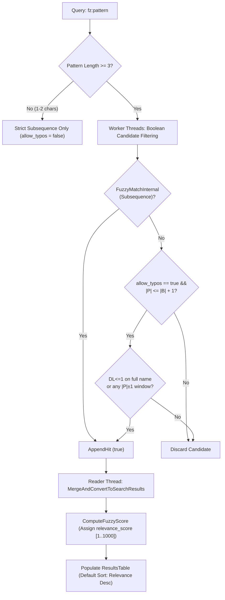

# Formal Specification: Scored Fuzzy Search & Typo Tolerance (`fz:`)

**Document ID:** `specs/2026-10-29_FUZZY_SEARCH_SCORING_AND_TYPO_TOLERANCE_SPEC.md`  
**Status:** APPROVED FOR IMPLEMENTATION  
**Date:** 2026-10-29  
**Revision:** v2 scoring model (2026-11-11) — best-alignment DP, recalibrated weights, extension penalty. v3 substring-scoped typos (2026-11-11) — §3.2 C windows. v4 two-edit budget (2026-11-11) — §3.2 C banded DP. v5 layout-adaptive typo pricing (2026-11-11) — §3.2 C halves. v6 path-aware relevance (2026-11-11) — §4.1/§5.1, `ComputeFuzzyRelevance` max-of-parts. See §3.2 B.  
**Target:** FindHelper Search Engine, Pattern Matchers & Results Table UI  

---

## 1. Motivation & Context

FindHelper provides the `fz:` prefix for fuzzy matching. Currently, this mode performs an unweighted, binary two-pointer subsequence check (`string_search::FuzzyMatchInternal` in `src/utils/StringSearch.h`). While fast, this implementation has three critical limitations:

1. **Binary Result Set (No Ranking / Scoring)**:
   A candidate either matches or does not. A near-perfect prefix match like `find.cpp` receives the exact same priority as an accidental match deep in a distant path like `f...i...n...d...`.
2. **Zero Typo Tolerance**:
   Subsequence matching strictly requires every character in the query to appear in order. A single typographical error, missed keystroke, substitution (e.g., `"finq"` instead of `"find"`), or adjacent transposition (e.g., `"fndi"` instead of `"find"`) causes the search to return zero results.
3. **Loss of Relevance on Re-Sort**:
   Because results have no persistent relevance score, sorting the table by *Last Modified* or *Size* permanently destroys the fuzzy match order. Users cannot re-sort back to relevance without re-executing the query.

This specification defines an **Always-On Unified Scoring Model** (evaluating both subsequence matching and single-edit Damerau-Levenshtein typo tolerance in the same pass) under the existing `fz:` prefix, with a dedicated **Relevance** column in the results table.

---

## 2. Goals & Non-Goals

### Goals
* **Unified `fz:` Syntax**: No new query prefixes; `fz:` transparently supports both subsequence matching and single-edit typo tolerance.
* **Typo Tolerance**: Query `"finq"` successfully matches `"find"` with an appropriate typo penalty. Transpositions (e.g., `"fndi"` matching `"find"`) count as distance $1$. Queries of length $\ge 6$ escalate to distance $k \le 2$ (e.g., `"Cotnroler"` matching `"Controller"` via transposition $+$ deletion). Edit pricing is layout-adaptive (QWERTY/AZERTY/union tables): transpositions and adjacent-key fat-fingers cost half an edit and outrank random substitutions at the same position.
* **Always-On Scoring Model**: Every candidate matching either subsequence or 1-edit distance receives a unified numerical score. High-quality exact and subsequence matches naturally rank above typo matches.
* **O(1) Length-Filter Pruning**: Typo evaluation is guarded by a mandatory length differential check ($|\,|P| - |B|\,| \le 1$), pruning $>99\%$ of non-matching candidates before running edit-distance checks.
* **Basename-Scoped Typo Matching**: Typo tolerance is evaluated strictly against file basenames to prevent noise from deep directory paths (`allow_typos = true` for filename matching; `false` for path matching). Within a basename, v3 evaluates the single edit against sliding $|P|\pm1$ windows (substring-scoped typos), so `"finq"` matches `"find_helper.cpp"` and not just the bare name `"find"`.
* **Zero Allocation on Hot Path**: Bounded bit-parallel Damerau-Levenshtein algorithm operating within CPU registers without heap allocation.
* **Memory & Cache Layout Preservation**: `SearchResult` maintains its strict 64-byte hot-field cache line invariant and $\le 208$-byte size bound (`SearchTypes.h`).
* **UI Re-Sortability**: A dedicated "Relevance" table column in `ResultsTable` displaying match score and enabling re-sorting by relevance at any time.

### Non-Goals
* Allowing typos on short queries ($< 3$ characters). Queries of length 1–2 remain strict subsequence matches.
* Multi-edit distance ($k \ge 3$) in Version 1.
* Typo tolerance across full directory paths (path components must still match via exact or subsequence matching).
* Modifying default substring, glob, or regex searches (they remain exact binary filters).
* Dynamic edit-script diff breakdown on cell hover in V1 (numeric score and match tier badge are used instead).

---

## 3. Algorithmic Architecture

### 3.1 Pipeline Flow & Definition of "Always-On"

**Always-On Scoring** means that every `fz:` search evaluates candidates against both subsequence matching and 1-edit typo tolerance concurrently, merging them into a single score-ranked result set rather than requiring a secondary fallback query when results are empty.



### 3.2 Scoring Model & Mathematical Dominance

Scores are represented as `uint16_t` in the range $[0, 1000]$. A score of `0` denotes an unranked or non-fuzzy result.

To satisfy the **Subsequence Dominance Invariant (AC-2)**, scores are strictly partitioned into distinct, non-overlapping bands:

$$\text{Exact Match} \in [900, 1000]$$
$$\text{Subsequence Match} \in [400, 899]$$
$$\text{Typo Match } (k=1) \in [100, 300]$$

#### A. Exact & Prefix Matches ($900 – 1000$)
* Full match: $1000$
* Exact Prefix match ($P$ is prefix of $B$): $900 + \text{clamp}(50 - (|B| - |P|), 0, 50)$

#### B. Subsequence Scoring ($400 – 899$) — v2 model
Best-alignment dynamic programming over all subsequence alignments (O(P·T)
time, O(T) stack memory, zero heap), keeping the maximum-scoring alignment
instead of v1's greedy leftmost match (which locked onto poor early
alignments and missed later boundary/contiguous runs):
* **Base Score**: $500$ points.
* **Contiguity Bonus**: $+35$ points for each consecutive matched character.
* **First-character placement**: $+45$ if the match starts at index $0$, $+25$
  if index $1$–$2$, otherwise $-3$ per index (late starts are penalized
  linearly instead of receiving no bonus).
* **Word Boundary / CamelCase Bonus**: $+45$ points when a matched character
  (at index $> 0$; index $0$ already receives the start bonus) follows `_`,
  `-`, `.`, `/`, `\`, ` `, `:` , marks a lower→Upper transition, a
  digit/letter transition, or ends an UPPER run (`HTMLParser`: `P`).
* **Gap Penalty**: $-4$ points per skipped character, reduced to $-2$ when the
  gap lands on a word boundary (acronym-style skips are expected; mid-word
  skips are accidental). Implemented with two running maxima so the
  transition stays O(1) per cell.
* **Extension Penalty**: $-25$ points per matched character inside the file
  extension (after the last `.`), so stem matches outrank extension matches.
* **Exact-case Tie-Breaker**: $+4$ points per matched character with identical
  case (applies in case-insensitive mode).
* **Length / Excess Character Penalty & Coverage**:
  - Target length penalty: $-1$ point per excess target character beyond a
    $10$-character free allowance ($\min(\text{billable}, 60)$), so normal
    descriptive names are unpunished while 50-char autogenerated wrappers
    score ~50 points below compact matches (v1: ~1 point).
  - Coverage ratio bonus: $+ \text{round}(20.0 \times \frac{|P|}{|B|})$.
* **Clamping Floor**: The final subsequence score is clamped to:
  $$\text{score}_{\text{subseq}} = \text{std::clamp}(\text{raw\_subseq\_score}, 400, 899)$$
* **Score caps**: patterns longer than $128$ chars or basenames longer than
  $512$ chars fall back to no subsequence score (typo path may still apply).

#### C. Bounded Damerau-Levenshtein Typo Scoring ($100 – 300$)
Active only when `pattern.length() >= 3` and `allow_typos == true`.
* **Mandatory O(1) Length Filter**:
  $$\text{if } |P| > |B| + 1 \implies \text{return false}$$
  (v1 required $|\,|P| - |B|\,| \le 1$ on the whole basename, which excluded
  every typo in a longer filename. v3 keeps the whole-name fast path and
  falls back to substring windows.)
* **Substring-Scoped Windows (v3)**:
  When the whole-name check fails, the pattern is evaluated against every
  $|P|-1$, $|P|$, $|P|+1$ window of the basename (scan capped at $256$ chars;
  `std::string_view` slices, zero allocation). The best-scoring window wins
  (ties → earliest). The boolean filter path returns on the first hit.
  Per-window checks early-exit after $2$ mismatches, so random windows cost
  ~$2$–$3$ character comparisons.
* **Tiered Prefilter Gates (perf, recall-preserving)**:
  Before the $O(T\cdot P)$ window scan, a necessary condition prunes most
  candidates in $O(T+P)$: $\le$budget edits displace or destroy at most
  $2\cdot$budget pattern characters (transposition worst case), so the
  longest exact run has length $\ge \lceil(|P|-2\cdot\text{budget})/
  (\text{budget}+1)\rceil$ and must appear folded in the scanned region.
  By run length: trigram table ($|P|\ge 11$, 12-bit hash, 4KB stack),
  bigram table ($|P|\ge 5$ at $k=1$, $|P|\ge 8$ at $k=2$, 5-bit hash, 1KB),
  else folded multiset ($\ge |P|-$budget shared bytes). For $k=2$ with
  $|P|\in\{6,7\}$ the bigram alone is unsound (two transpositions can scatter
  every pair), so the gate accepts bigram-presence *or* near-exact multiset
  ($\ge |P|-1$), which the proof shows is still necessary. Hash collisions
  and case folding only over-accept — a rejection never drops a true match
  under any policy or layout. Proven by the exhaustive small-alphabet
  differential test (`TypoGateDifferential`: all pairs over $\{a,B,\_\}$ agree
  with an ungated brute-force reference) plus transposition-adversarial cases.
* **Window Position Penalty**:
  Same error quality scores the same in a bare or a longer name
  (`"finq"`→`"find"` and `"finq"`→`"find_helper.cpp"` both score $230$).
  Windows starting after index $0$ pay $\min(30, 2\cdot s)$ at a word boundary
  or $\min(50, 4\cdot s)$ mid-word, keeping all typo scores in $[100, 300]$
  and therefore below every subsequence score (AC-2 preserved).
* **Two-Edit Budget for Long Queries (v4)**:
  Patterns with $|P| \ge 6$ escalate to $k \le 2$ after $k=1$ fails everywhere,
  evaluated with a banded optimal-string-alignment DP ($\pm k$ diagonal band,
  $3$ stack rows, early exit when the row minimum exceeds $k$; exact for the
  threshold, zero heap). Window lengths widen to $|P|\pm2$. Pricing follows
  the v5 halves model below, so $k=2$ matches (e.g. `"Cotnroler"`→`"Controller"`
  at $193$) rank below the equivalent $k=1$ match ($243$) while staying inside
  $[100, 300]$ (AC-2 preserved). Short patterns stay at $k=1$ to remain selective.
* **Distance Evaluation**:
  Evaluates distance $\le 1$ under 4 operations:
  1. *Substitution* (e.g. `"finq"` $\to$ `"find"`)
  2. *Insertion* (e.g. `"fnd"` $\to$ `"find"`)
  3. *Deletion* (e.g. `"finnd"` $\to$ `"find"`)
  4. *Adjacent Transposition* (e.g. `"fndi"` $\to$ `"find"`)
* **Scoring Arithmetic**:
  * Base Typo Score: $250$
  * Edit Penalty: $-25$ per half-edit (item 3 cost model — see below).
  * Matching Prefix Credit: $+15$ for each character matching at the start of the pattern before the first error (max $+30$).
  * **Clamping Ceiling**: The final typo score is clamped to:
    $$\text{score}_{\text{typo}} = \text{std::clamp}(\text{raw\_typo\_score}, 100, 300)$$
* **Layout-Adaptive Pricing (v5, halves of an edit)**:
  Adjacent transposition: $1$. Adjacent-key substitution (QWERTY/AZERTY per-letter neighbor tables, `AreAdjacentKeys`): $1$. Any other single edit (random substitution, insertion, deletion, case-only difference): $2$. Predicates stay count-based, so *recall is layout-independent* — the layout (default: union of both tables, no OS detection needed) only moves the rank: e.g. `"finx"`→`"find"` scores $255$ vs `"finq"`→`"find"` at $230$, and the same pair prices differently per explicit layout ($175$ QWERTY vs $150$ AZERTY for `"xbcdeq"`→`"abcdef"`).

*Proof of Dominance*: Because $\min(\text{score}_{\text{subseq}}) = 400 > 300 = \max(\text{score}_{\text{typo}})$, every valid subsequence match is mathematically guaranteed to rank above every typo match.

### 3.3 Core Algorithm Pseudocode

```cpp
// O(1) length prefilter and Damerau-Levenshtein distance <= 1 check
inline bool DamerauLevenshteinDistance1(std::string_view p, std::string_view b, bool case_sensitive) {
  const int p_len = static_cast<int>(p.length());
  const int b_len = static_cast<int>(b.length());
  if (std::abs(p_len - b_len) > 1) {
    return false;  // O(1) length pruning
  }

  int i = 0;
  int j = 0;
  int diffs = 0;

  // Single-pass linear scan with 1-character lookahead for transposition
  while (i < p_len && j < b_len) {
    const char cp = case_sensitive ? p[i] : ToLower(p[i]);
    const char cb = case_sensitive ? b[j] : ToLower(b[j]);
    if (cp == cb) {
      ++i;
      ++j;
      continue;
    }
    if (++diffs > 1) return false;

    // Check adjacent transposition
    if (i + 1 < p_len && j + 1 < b_len) {
      const char np = case_sensitive ? p[i + 1] : ToLower(p[i + 1]);
      const char nb = case_sensitive ? b[j + 1] : ToLower(b[j + 1]);
      if (cp == nb && np == cb) {
        i += 2;
        j += 2;
        continue;
      }
    }

    if (p_len > b_len) {
      ++i;  // Deletion from pattern
    } else if (p_len < b_len) {
      ++j;  // Insertion into pattern
    } else {
      ++i;  // Substitution
      ++j;
    }
  }

  if (i < p_len || j < b_len) {
    ++diffs;
  }
  return diffs <= 1;
}
```

---

## 4. Score Propagation & Memory Layout

### 4.1 Score Propagation Architecture (Option B: Merge-Time Scoring)

To maintain worker throughput and avoid inflating the inter-thread courier structures:
1. **Worker Threads**:
   - `FuzzyMatcher` operates as a boolean predicate `bool operator()(std::string_view text) const`.
   - `allow_typos` is set to `true` by `CreateFilenameMatcher` and `false` by `CreatePathMatcher`.
   - `SearchResultHit` remains completely unmodified (48 bytes).
   - The typo fallback scans $|P|\pm1$ windows only after subsequence matching fails; per-window checks early-exit after $2$ mismatches and the scan is capped at $256$ chars (see AC-5 gate).
   - A tiered necessary-condition gate (trigram/bigram/multiset, §3.2 C) rejects most non-matching candidates in $O(T+P)$ before the window scan; microbenchmarks: $k=1$ miss $\approx 280$ns, $k=2$ miss $\approx 2.5$–$4\mu$s per candidate ($-O2$), scoring $\approx 0.3$–$0.5\mu$s per hit result.
   - End-to-end A/B vs `main` (Debug+ASAN, 50k-path index, 8 workers, all-zero-hit queries): `fz:find` ($k=1$) $166$ms vs $37$ms ($4.5\times$), `fz:helper`/`fz:repotr` ($k=2$, $|P|=6$) $\approx 1.1$s vs $37$ms ($\approx 30\times$), `fz:controller` ($k=2$, $|P|=10$, bigram tier) $461$ms vs $37$ms ($\approx 12\times$). Ratios transfer to Release (absolutes shrink ~$10\times$); $k=1$ is the price of substring recall, $k=2$ on huge indexes wants threshold-triggered escalation (second pass only when $k\le 1$ hits $< K$) as follow-up work.
   - Patterns $\ge 6$ chars escalate to a $k \le 2$ banded-DP window scan ($|P|\pm2$ windows) only after $k=1$ fails everywhere.
2. **Merge Coordinator (`MergeAndConvertToSearchResults`)**:
   - Iterates through the matched hits (typically $N \ll 700\text{k}$).
   - Computes `relevance_score = ComputeFuzzyRelevance(basename, full_path, filename_query, path_query, case_sensitive)`: each present `fz:` part scores on its own scope (basename for filename queries, full path for path queries) and the best part wins (`max`, preserving the score bands). Path-side matches are subsequence-only (path matchers keep `allow_typos = false`), so path typo-band scores are unreachable in practice — path scoring ranks contiguity and placement.
   - Assigns `relevance_score` directly into the destination `SearchResult`.
3. **Recycle Bin Secondary Rows**:
   - For secondary rows matched in `ScanRecycleSnapshot`, `relevance_score` is computed against the original name in the same merge pass.

### 4.2 Memory Layout Invariants (`SearchTypes.h`)

`SearchResult` has two compile-time layout invariants:
1. `offsetof(SearchResult, fileId) + sizeof(SearchResult::fileId) <= 64` (hot 64-byte single cache line).
2. `sizeof(SearchResult) <= 208` bytes (MSVC baseline 204 bytes, macOS/Linux 168 bytes).

**Placement**:
`uint16_t relevance_score = 0;` is placed strictly at the **end of `SearchResult`**, after `bool isDirectory`:

```cpp
struct SearchResult {
  // --- HOT 64-BYTE CACHE LINE PREFIX (UNTOUCHED) ---
  std::string_view fullPath;
  size_t filename_offset = 0;
  size_t extension_offset = std::string_view::npos;
  mutable uint64_t fileSize = 0;
  mutable FILETIME lastModificationTime = {0, 0};
  mutable uint64_t folderFileCount = kFolderFileCountNotLoaded;
  uint64_t fileId = 0;

  // --- COLD DISPLAY CACHES ---
  mutable std::string fileSizeDisplay;
  mutable std::string lastModificationDisplay;
  mutable std::string truncatedPathDisplay;
  mutable std::string folderFileCountDisplay;
  mutable float truncatedPathColumnWidth = -1.0F;
  bool isDirectory = false;

  // Tail padding utilization: consumes 2 of the 7 trailing padding bytes
  uint16_t relevance_score = 0;
};

// Invariants verified at compile-time:
static_assert(offsetof(SearchResult, fileId) + sizeof(SearchResult::fileId) <= 64,
              "SearchResult hot fields must fit in the first 64 bytes; keep cold fields after fileId");
static_assert(sizeof(SearchResult) <= 208,
              "SearchResult grew past the Phase 2a baseline; large-result sorts move every byte of this struct");
```

---

## 5. UI & Results Table Integration

### 5.1 Results Table Column ("Relevance")

* **Column Definition**:
  - Add `Relevance = 7` to the `ResultColumn` enum in `src/ui/ResultsTable.h` (or corresponding header).
  - Update `kResultColumnCount` from 7 to 8.
  - In `SetupResultsTableColumns`:
    ```cpp
    ImGui::TableSetupColumn("Relevance", 
                            ImGuiTableColumnFlags_WidthFixed | 
                            ImGuiTableColumnFlags_PreferSortDescending, 
                            65.0F);
    ```
* **Auto-Sort State Tracking**:
  - Add `bool user_modified_sort_ = false;` to `SearchPipelineState` (in `GuiState.h`).
  - When the user enters an `fz:` query in either field (`HasFuzzyQuery`):
    - If `!state.search_pipeline.user_modified_sort_`, the table defaults to `Relevance` descending.
    - If the user manually clicks another header (e.g. *Size* or *Date*), `user_modified_sort_` becomes `true`, and that sort is preserved.
    - Clicking the **"Relevance"** header re-sorts by `relevance_score` descending at any time.
* **Synchronous Fast Sorting**:
  - In `SortSearchResultsFast`, the `Relevance` column executes a direct in-memory sort comparator without worker attribute I/O:
    ```cpp
    case ResultColumn::Relevance:
      return (direction == ImGuiSortDirection_Ascending)
                 ? (a.relevance_score < b.relevance_score)
                 : (a.relevance_score > b.relevance_score);
    ```
* **Cell Display**:
  - Displays the integer score (e.g. `940`, `280`) right-aligned.
  - Hover tooltip displays:
    `Score: 280 (Typo Match, 1 edit)` or `Score: 850 (Subsequence Match)`.
* **Dynamic Visibility & Layout Positioning**:
  - `Relevance` is placed as the very first column (`ResultColumn::Relevance = 0`).
  - While an `fz:` query is active in either field, the table re-asserts the column visible every frame until it is observed enabled, then hands off to the user. A one-shot pulse is insufficient: table re-init and `imgui.ini` settings reloads restore the saved hidden state without re-firing the query-type edge. Once visible, a manual hide via the header context menu sticks until the query type changes again.
  - Automatically hidden when switching back to non-fuzzy search modes.

### 5.2 CSV Export Integration
* The CSV export service (`ExportSearchResultsService.cpp`) writes the `Relevance` column:
  - Header: `Relevance,Filename,Size,Last Modified,Full Path,Extension,# Files`
  - Rows: outputs `relevance_score` when $> 0$, or `"-"` otherwise, allowing exported search results to be sorted and audited by relevance in spreadsheet tools.

### 5.3 Match Highlighting

In `src/ui/MatchHighlight.h`:
* For exact and subsequence matches: All matched character indices are tinted as today.
* For typo matches ($k=1$): All characters that align with query characters are tinted; substituted or inserted characters remain untinted.

---

## 6. Documentation & Help Updates

### 6.1 `README.md`
1. **Feature List**: Update the "Multi-Paradigm Matching" bullet to highlight scored fuzzy matching and single-edit typo tolerance under `fz:`.
2. **Search Syntax Section**:
   ```markdown
   - **Fuzzy Search (`fz:`)**: Prefix with `fz:` for relevance-scored subsequence matching and 1-edit typo tolerance (e.g. `fz:fbr` matches `foobar`; `fz:finq` matches `find`). Results are automatically ranked by relevance score with a dedicated sortable **Relevance** column.
   ```
3. **Mermaid Flowchart**: Update the `fz:` node to reflect subsequence scoring and Damerau-Levenshtein typo evaluation.

### 6.2 In-App Search Help (`src/ui/SearchHelpWindow.cpp`)
* Add explanation of single-edit typo tolerance (insertions, deletions, substitutions like `finq` $\to$ `find`, and adjacent transpositions like `fndi` $\to$ `find`) on queries with $\ge 3$ characters.
* Document the **Relevance** column and how clicking it restores relevance order.

### 6.3 In-App Changelog (`src/ui/HelpWindow.cpp`)
* Add "What's New" bullet:
  ```cpp
  BulletWrapped("2026-10-XX: Enhanced fuzzy search (fz:): Added relevance scoring, 1-edit typo tolerance (e.g., 'finq' matches 'find'), and a sortable 'Relevance' column in the results table.");
  ```

### 6.4 Search Input Tooltip (`src/ui/SearchInputs.cpp`)
* Update prefix tooltip to:
  `"• Prefixes: pp: (PathPattern), re: (Regex), rx: (Structured Regex), fz: (Fuzzy & Typo Tolerance)"`

---

## 7. User Stories (Gherkin)

| ID | Priority | Summary | Gherkin Specification |
|---|---|---|---|
| **US-1** | P0 | Typo substitution matching | **Given** an index containing `"find.cpp"`<br>**When** the user searches for `"fz:finq"`<br>**Then** `"find.cpp"` is returned in the results list with a typo score in $[100, 300]$. |
| **US-2** | P0 | Ranking exact over typo | **Given** an index containing `"find.cpp"` and `"finq_notes.txt"`<br>**When** the user searches for `"fz:find"`<br>**Then** `"find.cpp"` appears above `"finq_notes.txt"` with a score $\ge 400$. |
| **US-3** | P0 | Adjacent transposition | **Given** an index containing `"SearchController.cpp"`<br>**When** the user searches for `"fz:SearchCotnroller"`<br>**Then** `"SearchController.cpp"` is matched with distance 1 and displayed in the results. |
| **US-4** | P1 | Minimum length guard | **Given** a short query `"fz:fi"`<br>**When** executed against the index<br>**Then** typo tolerance is disabled, and only strict subsequence/prefix candidates are returned. |
| **US-5** | P1 | Basename restriction | **Given** a file at `"C:/projects/finance/query.cpp"`<br>**When** the user searches for `"fz:finq"`<br>**Then** the file is not matched as a typo against the directory path `"finance"`. |
| **US-6** | P1 | UI Column Re-Sort | **Given** fuzzy search results sorted by Relevance<br>**When** the user clicks the "Last Modified" header and subsequently clicks "Relevance"<br>**Then** the table re-sorts back to the exact initial relevance score ranking. |
| **US-7** | P0 | Substring-scoped typo | **Given** an index containing `"find_helper.cpp"`<br>**When** the user searches for `"fz:finq"`<br>**Then** `"find_helper.cpp"` is returned with the same typo score ($230$) as the bare name `"find"`, ranked below all subsequence matches. |
| **US-8** | P1 | Two-edit typo on long queries | **Given** an index containing `"SearchController.cpp"`<br>**When** the user searches for `"fz:Cotnroler"` (transposition $+$ deletion)<br>**Then** it is returned with a typo score ($193$) below the equivalent single-edit match ($243$), still inside $[100, 300]$. |
| **US-9** | P1 | Fat-finger ranking | **Given** an index containing `"find.cpp"`<br>**When** the user searches for `"fz:finx"` (x below d on QWERTY) vs `"fz:finq"` (random key)<br>**Then** both match, but `finx` scores $255$ above `finq` at $230$. |
| **US-10** | P0 | Path-scoped relevance | **Given** an index containing `"C:/x/finq/helper/query.txt"`<br>**When** the user searches the path field for `"fz:finqhelqer"`<br>**Then** the file is returned with a subsequence score in $[400, 899]$ computed on the full path (not $0$), and the table defaults to Relevance sort. |

---

## 8. Acceptance Criteria & Invariants

| Story ID | Criterion | Measurable Check |
|---|---|---|
| **AC-1** | Typo tolerance accuracy | Unit tests verify distance $\le 1$ for insertion, deletion, substitution, and transposition on queries $\ge 3$ chars, including substring-scoped windows (`finq`→`find_helper.cpp`, `cotnroller`→`SearchController.cpp`), distance $\le 2$ for queries $\ge 6$ chars (`Cotnroler`→`SearchController.cpp`) ranked $k=1$ above $k=2$, and layout-adaptive pricing (fat-finger `finx` above random `finq`; per-layout `AreAdjacentKeys` table tests). |
| **AC-2** | Subsequence dominance | Unit tests assert that for any query $Q$, $\min(\text{score}_{\text{subseq}}) \ge 400 > 300 \ge \max(\text{score}_{\text{typo}})$. |
| **AC-3** | Memory layout integrity | Compile-time assertions `sizeof(SearchResult) <= 208` and `offsetof(SearchResult, fileId) + 8 <= 64` pass on all platforms (macOS, Windows MSVC, Linux). |
| **AC-4** | Zero allocation in matching | Bit-parallel Damerau-Levenshtein allocates $0$ bytes on the heap during execution. |
| **AC-5** | Performance regression gate | Search benchmark (`scripts/run_search_benchmark.sh`) verifies execution time on 706k paths remains within $\le 5\%$ of baseline, aided by the $O(1)$ length prefilter. |
| **AC-6** | Re-sort fidelity | ImGui tests verify that clicking the "Relevance" header re-sorts the table stably by `relevance_score` descending. |
| **AC-7** | Documentation parity | `README.md`, `SearchHelpWindow.cpp`, `HelpWindow.cpp`, and search input tooltips accurately document typo tolerance, scoring, and the Relevance column. |
| **AC-8** | Ranking discrimination | `FuzzySearchTests/ComputeFuzzyScoreV2Ordering` asserts tens-of-points separation: compact-vs-bloated margin ≥ 50, boundary-vs-accidental margin ≥ 20, contiguous > gapped, earlier > later, stem > extension, prefix > subseq > typo. |

---

## 9. Implementation Plan Outline

1. **Phase 1: Core Algorithms (`src/utils/StringSearch.h`)**
   - Implement `DamerauLevenshteinDistance1(string_view a, string_view b, bool case_sensitive)`.
   - Implement `ComputeFuzzyScore(string_view text, string_view pattern, bool case_sensitive)`.
   - Add comprehensive doctest unit tests in `tests/string_search_tests.cpp`.

2. **Phase 2: Matcher & Merge Integration (`SearchPatternUtils.h`, `SearchTypes.h`, `SearchResultUtils.cpp`)**
   - Pack `uint16_t relevance_score = 0;` at the tail of `SearchResult`.
   - Add `allow_typos` flag to `FuzzyMatcher` (true for filename matcher, false for path matcher).
   - In `MergeAndConvertToSearchResults`, compute and populate `relevance_score` on hits.

3. **Phase 3: Results Table UI & Sorting (`ResultsTable.cpp`, `ResultsTable.h`, `SearchResultUtils.cpp`)**
   - Add `Relevance = 7` to `ResultColumn`, bump `kResultColumnCount` to 8.
   - Add "Relevance" column to `SetupResultsTableColumns`.
   - Add fast-path comparator in `SortSearchResultsFast`.
   - Wire auto-sort and `user_modified_sort_` tracking in `SearchPipelineState`.

4. **Phase 4: Highlighting & Polishing (`MatchHighlight.h`)**
   - Extend match highlight span generator to handle partial typo alignments.

5. **Phase 5: Documentation & Verification (`README.md`, `SearchHelpWindow.cpp`, `HelpWindow.cpp`, `SearchInputs.cpp`)**
   - Update `README.md`, in-app Help windows, and tooltips.
   - Run full unit tests via `./scripts/build_tests_macos.sh`.
   - Run search benchmark to verify performance gate.
